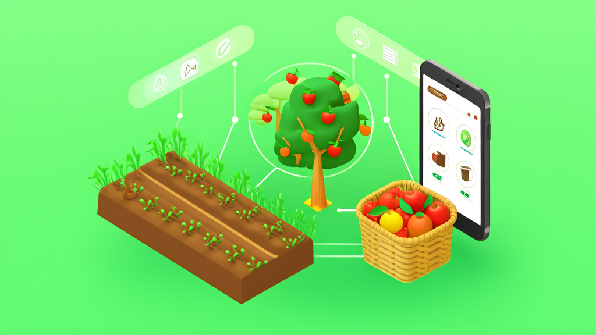

# 农场认养与农旅采摘  数字化平台

**农场认养系统与农旅采摘商城一体化案例｜智慧农业数字化平台-讯业信息**

智慧农业 / 农业数字化（家庭农场、生态农庄、共享菜园、果园牧场、田园综合体、乡村振兴项目） · 河南讯业信息科技有限公司

[📖 在线预览](https://xunyeit.github.io/nong-chang-ren-yang-yu-nong-lv-cai-zhai-shu-zi-hua-ping-tai/) · [🌐 公司官网](https://www.xunyeit.com) · [💼 更多案例](https://cms.xunyeit.com/)

---

## 案例摘要

河南讯业信息科技有限公司为家庭农场、生态农庄、果园牧场与田园综合体交付了一套智慧农业数字化平台，以“农场认养系统 + 农旅采摘管理平台 + 农产品商城小程序”为核心，用一套系统覆盖土地认养、畜牧认养、果树认养、农旅采摘、农产品商城5条业务线，共用会员、订单、支付、物流与内容体系。平台交付81个C端业务接口、36个业务管理模块与290+管理接口、39张业务数据表，支持多农场、多基地数据隔离的统一运营。上线后，采摘报名与现场核销实现线上化免手工对账，认养过程按周可视化发布，农产品销售沉淀为可复购的会员资产。该方案面向缺少技术团队的农业经营主体，采用模块化分步上线，可显著缩短系统落地周期。

## 关键成果

| 指标 | 成果 |
|---|---|
| 一套智慧农业数字化平台覆盖的业务线数量 | 5条业务线（土地认养、畜牧认养、果树认养、农旅采摘、农产品商城），共用会员、订单、支付、物流与内容体系 |
| 平台交付的C端业务接口数量 | 81个C端业务接口（含登录认证），支撑公众号H5与微信小程序完整用户侧操作 |
| 平台后台管理规模 | 36个业务管理模块、290+个管理接口 |
| 平台业务数据表数量 | 39张业务数据表 |
| 实现的业务闭环范围 | 从商品配置、用户下单、支付、履约、物流、核销到售后评价的完整闭环，未核销订单可整单退款并自动返还库存 |
| 技术架构与扩展能力 | Spring Boot 3.2.1 / Java 17、MyBatis-Plus 3.5.5 / MySQL 8.0、Vue 3.5 / Vite 5、微信支付V3，采用多租户隔离与插件化设计，支持Docker容器化 |

# 智慧农业数字化平台落地案例：农场认养系统 + 农旅采摘 + 农产品商城一体化

> 河南讯业信息科技有限公司（简称“讯业信息”）交付的智慧农业数字化平台，用一套系统打通农场认养系统、农旅采摘管理平台与农产品商城小程序三条主线，帮助没有技术团队的农场快速上线完整的线上经营系统。

## 开篇摘要：一套系统跑通农场认养、采摘与农产品直销全流程

面向家庭农场、生态农庄、果园牧场与田园综合体的智慧农业数字化平台，以“认养 + 采摘 + 商城”为核心，帮助没有技术团队的农场在较短时间内上线完整的线上经营系统。

这套由讯业信息交付的农场认养系统，用一套系统覆盖土地认养、畜牧认养、果树认养、农旅采摘、农产品商城5条业务线，共用会员、订单、支付、物流与内容体系，形成从配置、下单、支付、履约、物流、核销到售后评价的完整业务闭环。平台交付81个C端业务接口、36个业务管理模块与290+管理接口、39张业务数据表，支持多农场、多基地数据隔离的统一运营。

对农场而言，直接收益集中在三件事上：采摘报名线上化、现场核销免手工对账；认养过程按周可视化发布；农产品销售能够沉淀为可复购的客户资产。

### 核心数据速览

| 维度 | 数据 |
| --- | --- |
| 业务线覆盖 | 5条（土地认养、畜牧认养、果树认养、农旅采摘、农产品商城） |
| C端业务接口 | 81个（含登录认证） |
| 后台管理规模 | 36个业务管理模块、290+个管理接口 |
| 业务数据表 | 39张 |
| 业务闭环 | 配置→下单→支付→履约→物流→核销→售后评价 |

## 行业背景与挑战：农业经营从“线下体验”走向“线上可售卖、可跟踪、可复购”

农业经营的对象正在发生变化。过去农场卖的是“当季的农产品”和“一次到访的采摘体验”，现在消费者还想知道这棵果树是谁在管、这块地种了什么、这批鸡养了多少天。消费端对溯源、过程透明与体验感的要求提升，倒逼农场把土地、果树、畜牧等生产资源，转化为可在线售卖的数字产品。

与此同时，农旅融合与乡村振兴项目持续增多，采摘、认养、直销三类业务天然并存：客户来采摘一次，可能顺手认养一棵果树；认养了一块菜地，又会在商城复购其他农产品。这三条业务线在客户侧是打通的，但在系统侧往往不是——社群接龙负责报名、Excel负责统计、单一商城负责卖货，数据各存一份。

更现实的约束是人的问题。农场普遍没有专职技术人员，系统必须开箱即用、按需组合、上线周期短，并且要能支撑后续的多基地扩张。农业数字化不是买一套软件就结束，而是要在缺少IT支撑的条件下长期跑得下去。

## 常见问题

**没有技术团队的农场能上线农场认养系统吗？**

可以。智慧农业数字化平台以开箱即用的管理后台 + 微信公众号H5/微信小程序为载体，业务模块按需组合，农场无需自行开发、无需配备专职技术人员，并可采用先上采摘与商城主链路、后上认养模块的分步上线策略缩短落地周期。

**土地认养、果树认养、畜牧认养、采摘和商城能用同一套系统管理吗？**

可以。平台用一套系统覆盖5条业务线（土地认养、畜牧认养、果树认养、农旅采摘、农产品商城），共用会员、订单、支付、物流与内容体系，交付81个C端业务接口、36个业务管理模块与290+管理接口、39张业务数据表，数据互通，不会出现多工具并行导致的数据割裂。

**采摘活动如何避免超卖和对账麻烦？**

活动与票种在线配置并绑定库存，用户报名支付即锁定名额并生成核销码，工作人员在后台完成核销，无需手工对账，超卖与对账问题在流程层面被消除；未核销订单可整单退款并自动返还库存。

**认养周期长，客户怎么看到认养过程？**

平台提供认养过程可视化模块，生长日记按周发布图文或视频、记录关键节点，并支持用户的互动请求反馈，把长周期认养变成可持续的内容输出，帮助农场建立信任、提升续认与转介绍。

**多农场、多基地如何统一运营与后续扩张？**

平台采用多租户数据隔离与插件化设计，按农场、基地做数据隔离，并提供标准REST接口对接小程序、H5、ERP、CRM，支持多基地统一管理、渐进式对接既有系统与后续复制扩张。

**农产品商城能承接采摘客户做复购吗？**

可以。农产品商城覆盖分类、规格、库存、购物车、下单支付、发货物流、评价与售后全链路，与采摘、认养共用会员体系，采摘客户可直接转化为可识别、可复购的商城客户资产。

## 关于 河南讯业信息科技有限公司

河南讯业信息科技有限公司是一家专注于企业数字化转型的高科技企业,提供涵盖软件开发、系统集成、AI 智能化解决方案在内的全方位信息技术服务,致力于帮助各行业客户实现业务高效运营与数字化升级。

## 联系我们

- 公司官网:[https://www.xunyeit.com](https://www.xunyeit.com)
- 案例库:[https://cms.xunyeit.com/](https://cms.xunyeit.com/)
- 交流电话:15538271057(微信同号)

> 关键词:智慧农业数字化平台、农场认养系统、农旅采摘管理平台、农产品商城小程序、认养农业解决方案、乡村振兴数字化、多租户农场管理、农业SaaS系统
